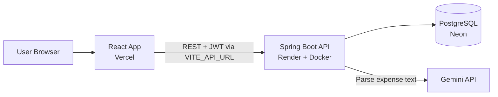
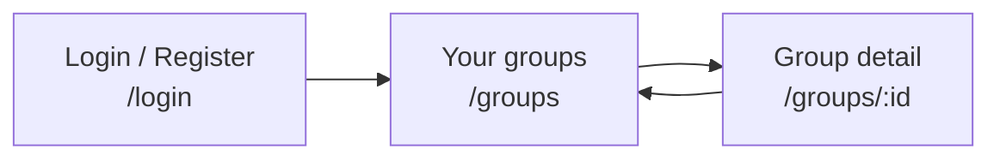
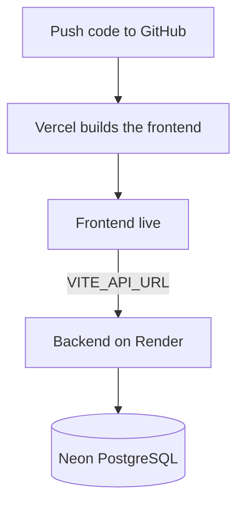

# Expense Splitter (Frontend)

Expense Splitter is a full-stack app for sharing group expenses, like Splitwise. Create a group, add expenses, see who owes whom, and settle up with the fewest payments. An AI sentence box fills in the expense form for you.

This repository is the **React frontend**. The Spring Boot backend is in a separate repository (linked below).

## Links

- **Live app:** https://expense-splitter-ui-three.vercel.app
- **Backend API:** https://expense-splitter-kyaa.onrender.com
- **Frontend source code:** https://github.com/AkshayJ-2028/expense-splitter-ui
- **Backend source code:** https://github.com/AkshayJ-2028/Expense-Splitter

> The backend runs on a free Render plan, so the first request after a period of inactivity can take up to a minute while the server wakes up. The login button shows "Please wait, server is starting..." during that time.

## Features

- Register and log in with JWT authentication
- Create groups, add members by email, and delete a group (creator only, with a confirmation prompt)
- Add expenses with equal, percent or exact splits, and choose who shares each expense
- **AI expense entry:** type a sentence like "Dinner 1200 paid by me, split with Rahul" and the form fills itself. You always review the draft before saving.
- See each member's balance and the shortest list of payments that clears all debts, and mark payments as paid
- Light and dark theme with a toggle on every screen. It follows your device setting at first, then remembers your choice.
- Wakes the sleeping backend as soon as the login page opens

## Tech Stack

| Layer | Technology |
|---|---|
| Frontend | React, Vite, React Router, Axios |
| Backend | Java 25, Spring Boot 4, Spring Security (JWT), Spring Data JPA |
| AI | Gemini API (called by the backend) |
| Database | PostgreSQL on Neon (production), H2 file database (local) |
| Hosting | Vercel (frontend), Render with Docker (backend) |

## Architecture



## Screens



| Route | Screen |
|---|---|
| `/login` | Log in or create an account |
| `/groups` | List your groups and create a new one |
| `/groups/:id` | Balances, who pays whom, add expense (with AI box), expense list, add member, delete group |

Routes other than `/login` need a logged-in user. Anyone else is sent to the login page.

## How the App Talks to the Backend

All requests go through one Axios instance in `src/api.js`. It:

- sends requests to `VITE_API_URL` (or `http://localhost:8080` when the variable is not set)
- attaches the saved JWT token as a `Bearer` header
- allows up to 90 seconds, so a sleeping backend has time to wake up

## Project Structure

```
expense-splitter-ui/
├── src/
│   ├── main.jsx          App entry point, applies the saved theme
│   ├── App.jsx           Routes and the private-route check
│   ├── api.js            Axios instance and backend wake-up call
│   ├── Login.jsx         Login and register screen
│   ├── Groups.jsx        Groups list
│   ├── GroupDetail.jsx   Group page: balances, expenses, members, delete group
│   ├── AddExpense.jsx    Expense form with the AI sentence box
│   ├── ThemeToggle.jsx   Light and dark mode switch
│   └── index.css         Theme colours and global styles
├── vercel.json           Rewrites every route to index.html
└── package.json          Dependencies and scripts
```

## Run Locally

### Prerequisites

- Node.js 18 or newer
- The backend running on port 8080 (see the backend README: https://github.com/AkshayJ-2028/Expense-Splitter)

### Start the frontend

```
git clone https://github.com/AkshayJ-2028/expense-splitter-ui.git
cd expense-splitter-ui
npm install
npm run dev
```

Open `http://localhost:5173`. By default the app talks to `http://localhost:8080`.

### Build for production

```
npm run build
```

The production files are created in `dist/`.

## Environment Variables

| Variable | Description |
|---|---|
| `VITE_API_URL` | Address of the backend, without a trailing slash. Optional locally, required on Vercel. |

To use a different backend locally, create a `.env` file in the project root:

```
VITE_API_URL=https://expense-splitter-kyaa.onrender.com
```

Restart `npm run dev` after changing it. On Vercel the value is read at build time, so redeploy after changing it.

## Deployment



- **Frontend:** Vercel project connected to the `main` branch, with `VITE_API_URL` set to the Render backend address.
- **`vercel.json`:** rewrites every address to `index.html`, so refreshing a page such as `/login` works instead of showing a 404.
- **Backend:** deployed separately on Render. See the backend README.

## Author

Akshay Kumar Jha
GitHub: [AkshayJ-2028](https://github.com/AkshayJ-2028)
